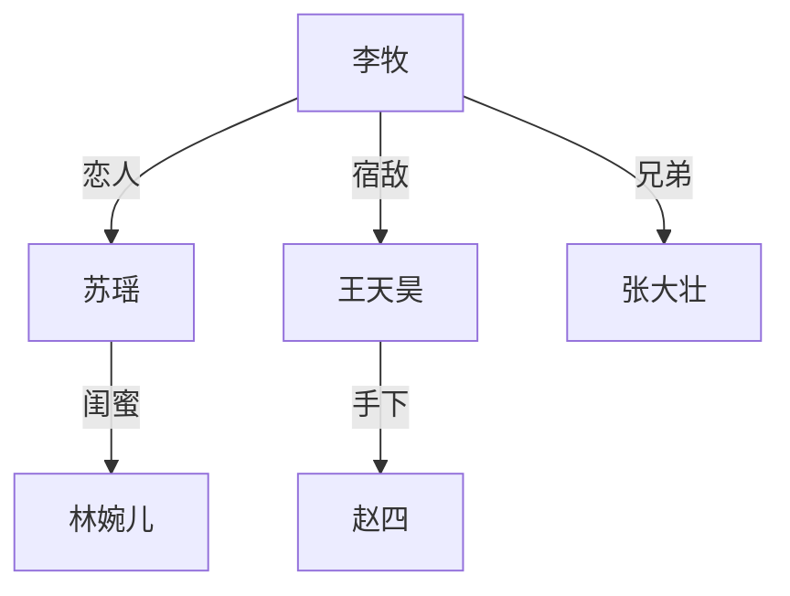
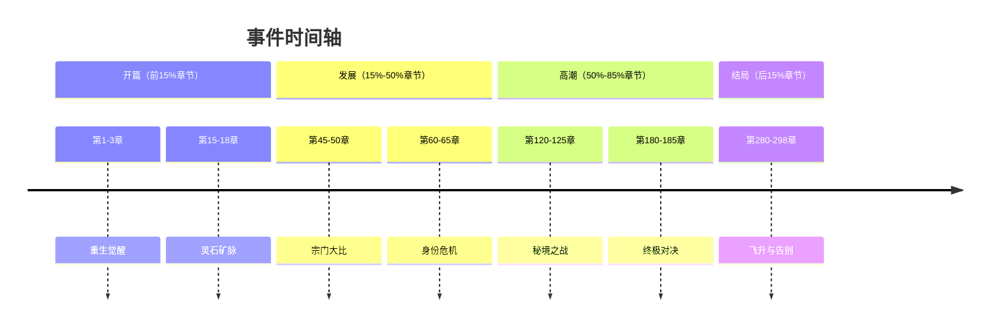

# 船板拆书 Skill 性能版 v2.0 — 用户指南

---

## 这是什么？

**一句话版本**：让 AI 帮你把一本网文拆成结构化分析报告——章节概括、人物关系、事件线、爽点分析，全都自动生成。

你有没有试过手动分析一本几百章的网文？读完后想整理人物关系、梳理事件时间线、看看哪些章节写得爽——然后发现光整理笔记就要花掉比读书还多的时间？

这套工具就是为了解决这个问题。

它是一套跑在 **Claude Code**（Anthropic 的 AI 编程工具）上的 Skill 组合。你只需要把小说文件丢给它，告诉它"帮我拆书"，它就会自动完成从拆分到分析的全流程。

### 它能做什么？

| 序号 | 功能 | 做什么用的 | 产出 |
|------|------|-----------|------|
| 1 | **拆分扫描** | 识别章节结构，把一整个 txt 文件切成一章一章的 MD 文件 | `拆分/` 文件夹，每章一个文件 |
| 2 | **分章节概括** | 每 3 章一组，生成约 500 字的剧情概括 | `概括/` 文件夹 + `全书概括.md` + `名词表.md` |
| 3 | **人物概括** | 梳理人物关系、角色重要性排名、感情线 | `角色地位.yaml` + `人物关系.yaml` + `关系图谱.md` |
| 4 | **事件概括** | 提取主线和支线事件链，生成时间轴 | `事件线.yaml` + `时间轴.md` |
| 5 | **ABC 爽点分析** | 分析每章的"铺垫→装逼→钩子"结构，找出爽点密集区 | `abc-ch{XXX}.yaml` + 全书汇总 + 热力图 + 快捷列表 |
| 6 | **自动化拆书** | 一键按顺序跑完上面所有功能 | 以上全部产出 |

### 谁适合用？

- **网文作者**：分析优秀作品的爽点结构，找到自己作品的薄弱章节
- **网文编辑**：快速了解一本书的人物关系和剧情走向
- **拆书爱好者**：不想手动整理笔记，让 AI 代劳
- **写作研究者**：想研究爽文结构的底层逻辑

---

## 核心流程：5 分钟理解全貌

整个拆书流程像一棵树——先走主干，再分枝杈：

```
       你的小说文件（.txt）
              │
              v
     ┌────────────────┐
     │  1. 拆分扫描    │   把一整本书切成一章一章的文件
     └────────┬───────┘
              │
              v
     ┌────────────────┐
     │  2. 分章节概括   │   每3章写一篇500字概括
     └───┬────┬────┬──┘
         │    │    │
         v    v    v      （三条线可以独立跑，互不影响）
    ┌────┐ ┌────┐ ┌────┐
    │人物│ │事件│ │ABC │
    │概括│ │概括│ │分析│
    └────┘ └────┘ └────┘
```

**关键依赖关系**：
- 拆分扫描是第一步，必须先做
- 分章节概括依赖拆分结果
- 人物概括、事件概括、ABC 分析都依赖分章节概括的结果
- 人物、事件、ABC 三者之间没有依赖，可以按任意顺序做

每个步骤产出什么？看下面这张完整的目录结构图：

```
你的书名/
├── 你的书名.txt              ← 源文件（拆分后自动移到这里）
├── 拆分/                     ← 步骤1产出
│   ├── 001_第一章_标题.md
│   ├── 002_第二章_标题.md
│   └── ...
├── 概括/                     ← 步骤2产出
│   ├── 组1_第1-3章_概括.md
│   ├── 组2_第4-6章_概括.md
│   └── _progress.json        ← 断点续传用的进度文件
├── 全书概括.md               ← 步骤2产出（全书剧情鸟瞰）
├── 人物和设定/               ← 步骤3产出
│   ├── 名词表.md             ← 步骤2产出（角色名称收录）
│   ├── 角色地位.yaml
│   ├── 人物关系.yaml
│   ├── 关系图谱.md           ← Mermaid 格式可视化
│   └── _分析笔记.md          ← AI的阅读思考过程
├── 事件线/                   ← 步骤4产出
│   ├── 事件线.yaml
│   ├── 时间轴.md             ← Mermaid 格式可视化
│   └── 初次事件线追踪.md
└── ABC分析/                  ← 步骤5产出
    ├── abc-ch001.yaml
    ├── abc-ch002.yaml
    ├── ...
    ├── abc-summary.yaml      ← 全书爽点统计
    ├── abc-heatmap.md        ← 爽点密度热力图
    └── abc-quick-list.md     ← 全书情节ABC标记速览
```

---

## 每个步骤详解

### 步骤 1：拆分扫描

#### 这一步做什么？

把一个完整的小说 txt 文件，按章节标题切分成独立的 Markdown 文件。

比如一本 300 章的小说，拆完就变成 300 个文件，每个文件对应一章。后续所有分析都基于这些拆好的章节文件进行。

#### 背后的原理

工具内置了一个 Python 脚本（`novel_splitter.py`），它用正则表达式匹配各种章节标题格式：

- "第一章"、"第二章"……
- "第1章"、"第2章"……
- "卷一"、"第一部"……
- "Chapter 1"……
- 序章、番外、终章等特殊标记

支持的层级包括：卷、部、篇、章、集、回、话、节。

#### 怎么用？

对 AI 说：

```
请帮我拆书。
任务：拆分扫描。
输入书籍：/Users/你的用户名/Desktop/从魔法少女开始独断万古.txt
```

> **路径怎么获取？** 在 Mac 上，右键点击文件 → 按住 Option 键 → 选择"拷贝文件路径"。在 Windows 上，按住 Shift 右键 → "复制文件路径"。

#### AI 会做什么？

1. **扫描阶段**：AI 调用 Python 脚本扫描你的文件，报告检测到的结构。比如：
   ```
   扫描结果：
   - 检测到 298 个章级标记
   - 检测到 12 个卷级标记
   - 特殊标记：序章 x1、番外 x3
   ```

2. **确认阶段**：AI 会问你想按哪个层级拆分（通常选"章"就行）

3. **执行阶段**：确认后自动拆分，源文件会自动移进项目文件夹

4. **完成报告**：告诉你产出了多少个文件，输出在哪个目录

#### 产出示例

```
从魔法少女开始独断万古/
├── 从魔法少女开始独断万古.txt    ← 源文件自动移入
└── 拆分/
    ├── 001_第一章_她是魔法少女.md
    ├── 002_第二章_觉醒之日.md
    ├── 003_第三章_黑暗降临.md
    └── ... (共 298 个文件)
```

---

### 步骤 2：分章节概括

#### 这一步做什么？

每 3 章为一组，生成一篇约 500 字的剧情概括。如果你的书有 300 章，就会产出 100 篇概括。

同时还会生成两个"全局视角"文件：
- **全书概括.md**：记录全书的主线剧情进展、主角里程碑、感情线
- **名词表.md**：收录出场的核心人物名称和别名

#### 为什么 3 章一组而不是逐章概括？

因为网文单章通常 2000-4000 字，信息密度有限。3 章放在一起恰好是一个叙事小单元，概括出来的内容更完整，也不会太碎片化。

#### 背后的架构（你不需要懂，但可以了解）

这一步用了"串行 sub-agent"架构——AI 会一组一组地处理，前一组的概括会传给下一组作为上下文。这样后面的组在写概括时就知道前面发生了什么，不会出现"突然冒出来一个角色不知道是谁"的问题。

```
组1（第1-3章）→ 组2（第4-6章）→ 组3（第7-9章）→ ...
    ↓ 传递上下文        ↓ 传递上下文        ↓
```

必须一组接一组跑，不能并行——因为后面的概括依赖前面的内容。

#### 怎么用？

如果你已经做完了拆分扫描：

```
请帮我拆书。
源项目目录：/Users/你的用户名/Documents/从魔法少女开始独断万古
任务：分章节概括
```

#### AI 会做什么？

1. 检查拆分目录是否存在（没有会提示你先拆分）
2. 统计总章数，计算需要分多少组
3. 检查是否有之前的进度（断点续传）
4. 一组一组执行，每完成一组显示进度条：
   ```
   [组 3/100] 第7-9章 ✓ 完成
   [组 4/100] 第10-12章 ✓ 完成
   ...
   ```
5. 所有组完成后输出报告

#### 两个实用功能

**断点续传**：如果中途断了（比如关了电脑、网络中断），下次继续时 AI 会自动检测进度文件 `_progress.json`，从断掉的地方接着跑，已完成的不会重做。

```
检测到未完成的概括任务：
- 书名：从魔法少女开始独断万古
- 已完成：第1-3组（9章）
- 待处理：第4-100组（291章）

继续上次任务？[Y/n]
```

**指定重做**：觉得某一组概括质量不好？可以让 AI 重做：

```
重新概括第3组
```

或者指定章节范围：

```
重做第11-15章的概括
```

#### 产出示例

`概括/组1_第1-3章_概括.md` 大概长这样：

```markdown
# 第1-3章 概括

李牧重生回到十年前的高中时代。他发现自己拥有了前世的所有记忆，
包括修炼功法、商业布局、以及那些曾经错过的机遇。

第一天重生，他在教室里重新见到了前世深爱但错过的苏瑶。这一世，
他决定不再犹豫。放学后他直奔城东的废弃工厂——那里藏着前世他
偶然发现但为时已晚的灵石矿脉……

（约500字，包含核心剧情和人物动态）
```

---

### 步骤 3：人物概括

#### 这一步做什么？

梳理全书的人物关系网——谁是主角，谁是女主，谁是反派，角色之间什么关系，重要性怎么排名。

最终产出三份文件：
- **角色地位.yaml**：每个角色的重要性排名（1-10分）
- **人物关系.yaml**：角色之间的关系（恋人、师徒、对手、亲属……）
- **关系图谱.md**：用 Mermaid 图表画出的可视化关系网

#### 背后的方法：模拟人类阅读

这一步很有意思——AI 不是简单地扫描关键词提取人名，而是模拟一个人类读者的阅读过程：

1. **先看全书概括和名词表**，建立初步假设："这个人可能是女主"、"这两个人可能有矛盾"
2. **带着问题去读章节概括**，边读边做笔记
3. **每读 10 次后暂停**，问你要不要继续（防止 AI 跑太久你不知道）
4. **归纳角色地位**，形成结论
5. **如果有拿不准的关系**，回到原文确认
6. **最终生成关系图谱**

#### 怎么用？

```
请帮我拆书。
源项目目录：/Users/你的用户名/Documents/从魔法少女开始独断万古
任务：人物概括
```

#### 产出示例

`角色地位.yaml`：
```yaml
protagonist:
  name: 李牧
  aliases: [牧哥, 李少]
  importance: 10

female_leads:
  - name: 苏瑶
    rank: 1
    importance: 9
  - name: 林婉儿
    rank: 2
    importance: 7

antagonists:
  - name: 王天昊
    rank: 1
    importance: 8

supporting:
  - name: 张大壮
    importance: 6
```

`关系图谱.md`（用 Mermaid 渲染后是这样的效果）：


> **Mermaid 怎么看？** 如果你用 Obsidian、Typora 或者 VS Code（装了 Markdown Preview Mermaid 插件），直接打开 `.md` 文件就能看到渲染好的关系图。也可以把代码粘贴到 [mermaid.live](https://mermaid.live) 在线查看。

---

### 步骤 4：事件概括

#### 这一步做什么？

提取全书的主要事件链——一条核心主线 + 2-3 条支线，串成一个清晰的事件时间轴。

产出两份文件：
- **事件线.yaml**：结构化的事件数据（什么章节发生了什么事，属于转折/高潮/铺垫/解决/揭示哪种类型）
- **时间轴.md**：用 Mermaid 画的可视化时间轴

#### 背后的方法：先梳理，再确认

和人物概括类似，这一步也是模拟人类思考过程：

1. **先读全书概括和分章节概括**，直接梳理出主线和支线
2. **审视自己的梳理结果**，看有没有不确定的地方
3. **对不确定的部分回到原文确认**（最多确认 10 次，防止无限循环）
4. **综合归档**，输出最终版本

#### 它不会做什么？

- 不会把感情线单独列为事件线（感情线已经在全书概括里总结过了）
- 不会罗列所有细节，只抓核心主线 + 2-3 条重要支线
- 不会无限制地回原文查——最多 10 次，够用了

#### 怎么用？

```
请帮我拆书。
源项目目录：/Users/你的用户名/Documents/从魔法少女开始独断万古
任务：事件概括
```

#### 产出示例

`事件线.yaml`（节选）：
```yaml
storylines:
  main:
    name: "重生逆袭之路"
    description: "李牧利用前世记忆在修真界崛起"
    events:
      - chapter_range: "1-3"
        title: "重生觉醒"
        type: turning_point
        summary: "李牧重生回十年前，保留前世记忆"
      - chapter_range: "15-18"
        title: "灵石矿脉"
        type: setup
        summary: "凭借前世记忆找到城东矿脉，获得第一桶金"
      - chapter_range: "45-50"
        title: "宗门大比"
        type: climax
        summary: "在宗门大比中击败王天昊，震惊全场"

  sub_1:
    name: "苏瑶线"
    description: "与前世深爱之人的重逢和守护"
    events:
      - chapter_range: "1-2"
        title: "教室重逢"
        type: setup
        summary: "重新遇到前世挚爱苏瑶"
```

`时间轴.md` 渲染后的效果（分为开篇、发展、高潮、结局四个阶段）：



---

### 步骤 5：ABC 爽点分析

#### 这一步做什么？

这是本工具最有特色的功能。它用一套叫"ABC 爽点分层分析法"的框架，拆解每一章的情绪结构：

- **A（铺垫 + 共情）**：主角的目标、处境、被小看——制造读者的期待感
- **B（装逼 + 反应）**：主角展示实力 + 周围人的反应——释放读者的爽感
- **C（嵌套 + 突然）**：章节结尾的钩子——让读者想翻下一章

#### 核心洞察：反应比装逼更重要

这是 ABC 分析法最反直觉的一点：**决定读者爽不爽的不是主角多厉害，而是别人的反应写了多少。**

想象一下：主角一拳打飞了反派（装逼）→ 然后直接切到下一个场景。你觉得爽吗？

再想象一下：主角一拳打飞反派（装逼）→ 之前嘲讽过主角的人脸色铁青（第1层反应）→ 围观群众全都哗然（第2层反应）→ 旁边一直没说话的宗门长老站起来说"此子不可限量"（第3层反应）→ 消息传遍整个城市，所有人都在讨论（第4层扩散效应）。

这就是 B 的反应层数的威力。这个工具会量化分析每章的反应层数和反应篇幅比。

**反应的标准分层**：

| 层级 | 谁在反应 | 示例 |
|------|---------|------|
| 第1层：质疑者 | 之前不信主角的人 | 愣住、沉默、表情崩裂 |
| 第2层：围观群众 | 大量路人NPC | 哗然、议论、震惊 |
| 第3层：嘲讽者 | 曾经嘲讽过主角的人 | 脸色铁青、后悔、羞愧 |
| 第4层：强者/重要人物 | 高手、美女、权贵 | 重新审视、开始重视 |
| 特殊层：扩散效应 | 更大范围的传播 | 消息传出，城里人人议论 |

#### 背后的架构：并行批处理

和分章节概括的串行不同，ABC 分析是**并行**的——因为每章的 ABC 分析是独立的，不需要知道前面章节的分析结果。所以 AI 会同时处理多个章节，速度快很多。

```
批次1（第1-5章）  ──┐
批次2（第6-10章） ──├── 同时跑（最多3批并行）
批次3（第11-15章）──┘
                    ↓ 等全部完成
              ┌─────────┐
              │ 全书汇总  │
              └─────────┘
```

#### 怎么用？

```
请帮我拆书。
源项目目录：/Users/你的用户名/Documents/从魔法少女开始独断万古
任务：ABC爽点分析
```

#### 产出文件详解

**单章分析**（`abc-ch001.yaml`）——每章一个文件，记录这一章有几个 ABC 循环，每个循环的 A/B/C 各打几星，B 的反应有几层，反应篇幅比多少：

```yaml
chapter_id: "045"
chapter_title: "宗门大比"

abc_cycles:
  - cycle_id: 1
    level: main
    summary: "李牧在宗门大比中击败王天昊"

    A:
      content: "王天昊当众嘲讽李牧是废物，宣称一招就能打败他"
      intensity: 4
      共情类型: 弱者共情
      铺垫手段:
        - "王天昊连胜三场的强势表现"
        - "围观弟子纷纷押注李牧会输"
      期待感: "读者知道李牧有隐藏实力，期待打脸时刻"

    B:
      装逼:
        content: "李牧一掌击飞王天昊，破碎王天昊引以为傲的护身灵甲"
        intensity: 4
      反应:
        content: "全场从嘲笑到震惊再到敬畏的情绪大反转"
        intensity: 5
        反应篇幅比: 2.8
        分层:
          - 层级: 质疑者
            内容: "刚才嘲笑李牧的弟子全部愣住，一片死寂"
          - 层级: 围观群众
            内容: "全场哗然，议论声此起彼伏"
          - 层级: 嘲讽者
            内容: "王天昊的跟班脸色铁青，后退数步"
          - 层级: 强者重评
            内容: "观战的长老站起身来：此子修为深不可测"
        B完整度: 合格

    C:
      content: "长老宣布李牧直接晋级内门弟子，但宗门秘境即将开启"
      intensity: 4
      类型: 嵌套
      下一循环预埋: "秘境之行将引出更强的对手"

chapter_summary:
  abc_density: 高
  structure_quality: 4.3
  main_cycle_b_quality: 合格
  overall_note: "经典爽文节奏，铺垫到位，反应层次丰富"
```

**全书汇总**（`abc-summary.yaml`）：

```yaml
overall_metrics:
  high_density_count: 45        # 高密度爽点章节数
  medium_density_count: 30      # 中密度
  low_density_count: 25         # 低密度
  abc_density_ratio: "45%"      # 高密度章节占比
  b_reaction_pass_rate: "68%"   # B反应合格率

top_chapters:                   # 最爽的5章
  - chapter_id: "045"
    title: "宗门大比"
    reason: "反应4层，篇幅比2.8，经典打脸章"

weak_chapters:                  # 最弱的5章（需要改进的）
  - chapter_id: "023"
    title: "修炼日常"
    reason: "无明确的B结构，整章都在铺垫"
    suggestion: "在修炼突破后补写2-3层外部反应"
```

**热力图**（`abc-heatmap.md`）：用表格标注每章的爽点密度，一眼看出全书的爽感节奏——哪里是高潮密集区，哪里是"干旱带"（连续好几章没爽点）。

#### 怎么用这些数据？

**如果你在分析别人的作品**：
1. 先看热力图，找到爽点峰值章节
2. 从峰值章往前数 2-3 章，那通常是最经典的 A 铺垫结构，值得反复研读
3. 打开那些章节的 yaml，看 B 的反应分层——作者是怎么一层一层堆叠反应的？这就是你可以直接学的技法

**如果你在分析自己的作品**：
1. 先看 `b_reaction_pass_rate`（B 反应合格率），这是你最该关注的指标
2. 找出所有 `main_cycle_b_quality: 不合格` 的章节
3. 这些章节的改法几乎是固定的：不需要重写装逼场景，只需要在装逼段之后补写 2-3 层外部反应
4. 找出"干旱带"——连续 3 章以上低密度的区间，考虑在中间插入一个小型 ABC 循环

---

## 一键全流程

如果你不想一步步手动来，直接用"自动化拆书"，AI 会按顺序跑完所有步骤：

```
请帮我拆书。
任务：自动化拆书。
输入书籍：/Users/你的用户名/Desktop/从魔法少女开始独断万古.txt
```

AI 会按这个顺序自动执行：

```
拆分扫描 → 分章节概括 → 人物概括 → 事件概括 → ABC爽点分析
```

中间会在关键节点征求你的确认（比如拆分粒度的选择），其余时间你可以去喝杯咖啡。

一本 100 章左右的网文，全流程大概需要几个小时（取决于你的 Claude Code 订阅类型和网络状况）。一本 300 章的书，可能需要半天到一天。

---

## 如何看懂产出文件

### YAML 文件怎么看？

YAML 是一种数据格式，比 JSON 更容易人眼阅读。你不需要懂编程，只要知道几个规则：

```yaml
# 井号开头的是注释，不影响内容

# 冒号前面是"键名"（标签），冒号后面是"值"（内容）
name: 李牧
importance: 10

# 短横线开头表示列表中的一项
aliases:
  - 牧哥
  - 李少

# 缩进表示层级关系
protagonist:
  name: 李牧           # "name" 属于 "protagonist" 这个分类
  importance: 10       # "importance" 也属于 "protagonist"
```

用任何文本编辑器（记事本、VS Code、Obsidian）都可以打开 `.yaml` 文件。推荐用 VS Code，它会给 YAML 加上语法高亮，看起来更清晰。

### 热力图怎么看？

`abc-heatmap.md` 是一个 Markdown 表格，用符号标注每章的爽点密度：

- 看到连续的"高"标记 = 爽点密集区，这里是全书最精彩的部分
- 看到连续的"低"标记 = 干旱带，这里节奏偏慢，如果是你自己的作品就需要注意

### 关系图和时间轴怎么看？

`关系图谱.md` 和 `时间轴.md` 里面都包含 Mermaid 代码。查看方式有三种：

1. **Obsidian**：直接打开就能看到渲染后的图表（Obsidian 原生支持 Mermaid）
2. **VS Code**：安装 "Markdown Preview Mermaid Support" 插件后预览
3. **在线查看**：打开 [mermaid.live](https://mermaid.live)，把代码块里的内容粘贴进去

---

## 常见问题

### Q：支持什么格式的小说文件？

**txt** 和 **epub** 格式。

txt 是最常见的，网上下载的小说通常就是 txt 格式。epub 也支持，工具会自动提取文本内容。

如果你的文件是其他格式（比如 PDF），需要先手动转换成 txt。

### Q：一本完整的网文，全流程跑完要多久？

取决于小说的长度：

| 章节数 | 大致耗时 | 备注 |
|--------|---------|------|
| 50 章以下 | 1-2 小时 | 短篇，很快 |
| 100 章左右 | 2-4 小时 | 中等长度 |
| 200-300 章 | 半天左右 | 长篇，建议分步骤做 |
| 500 章以上 | 1天+ | 超长篇，强烈建议分步骤做，善用断点续传 |

这些时间会受到你的网络状况和 Claude Code 服务器繁忙程度影响。

### Q：跑到一半断了怎么办？

**不要担心。** 每个步骤都有断点续传机制。

工具会在 `_progress.json` 文件中保存进度。下次继续时，AI 会自动检测到未完成的任务，问你要不要从上次断掉的地方继续。已完成的部分不会重做。

你只需要说：

```
请继续这个拆书项目。
源项目目录：/Users/你的用户名/Documents/从魔法少女开始独断万古
```

### Q：某组概括质量不好，能单独重做吗？

可以。直接告诉 AI：

```
重新概括第3组
```

或者指定章节范围：

```
重做第7-9章的概括
```

AI 会只重新跑这一组，覆盖原来的文件。

### Q：chardet 是什么？需要安装吗？

`chardet` 是一个 Python 库，用来自动检测文件编码（UTF-8 还是 GBK 等）。它是拆分扫描脚本的唯一外部依赖。

如果你在运行拆分扫描时遇到报错提示找不到 chardet，在终端执行：

```bash
pip install chardet
```

或者：

```bash
pip3 install chardet
```

装完就好了，只需要装一次。

### Q：我不用 Claude Code，能直接用吗？

这套工具是专门为 Claude Code 设计的 Skill 系统。你需要：

1. 有一个 Claude Code 账号（Anthropic 的产品）
2. 把 `skills/` 文件夹放到你的 `.claude/skills/` 目录下
3. 把 `workspace/CLAUDE.md` 的内容添加到你工作目录的 `CLAUDE.md` 中
4. 把 `workspace/novel_splitter.py` 放到你的拆书工作目录下

如果你不确定怎么配置 Claude Code，可以参考 Anthropic 的官方文档。

### Q：能分析非爽文类型的小说吗？

**可以，但有差异**：

- **拆分扫描、分章节概括、人物概括、事件概括** 这四个功能适用于所有类型的小说（言情、悬疑、科幻、文学……都行）
- **ABC 爽点分析** 主要针对网文爽文设计，对言情、悬疑等非典型爽文类型也能分析，但"B 反应层数"这个维度在纯文学作品中参考价值会降低

简单说：前 4 个功能是通用的，第 5 个功能（ABC分析）在爽文上效果最好。

### Q：文件名有特殊字符（书名号、空格）会出问题吗？

工具会自动处理。项目文件夹的命名统一使用书名（不带书名号），比如你的文件叫 `《从魔法少女开始独断万古》.txt`，项目文件夹名会是 `从魔法少女开始独断万古/`。

如果遇到因文件名导致的异常，可以手动把源文件重命名为不含特殊字符的名字再试。

### Q：产出的 YAML 文件能导入到其他工具吗？

可以。YAML 是标准的数据格式，任何支持 YAML 的工具都能读取。比如你可以用 Python 脚本做二次分析，或者导入到数据库中。

如果你只是想阅读分析结果，直接用文本编辑器打开就行，不需要额外工具。

---

## 附录：完整的指令句式模板

为了让 AI 准确理解你的意图，建议使用以下标准句式。复制粘贴后把路径替换成你自己的就行。

### 拆一本新书（全自动）

```
请帮我拆书。
任务：自动化拆书。
输入书籍：/Users/你的用户名/Desktop/书名.txt
```

### 只做拆分扫描

```
请帮我拆书。
任务：拆分扫描。
输入书籍：/Users/你的用户名/Desktop/书名.txt
```

### 只做某个分析步骤

```
请帮我拆书。
源项目目录：/Users/你的用户名/Documents/书名
任务：分章节概括
```

把"分章节概括"换成你想做的步骤——人物概括、事件概括、ABC爽点分析都行。

### 继续之前的项目

```
请继续这个拆书项目。
源项目目录：/Users/你的用户名/Documents/书名
```

### 重做某组概括

```
重新概括第3组
```

```
重做第11-15章的概括
```

---

> **最后一句话**：这套工具的核心理念是——你只管读书、思考、创作，琐碎的整理分析工作交给 AI。希望它能帮你在拆书和写作的路上省下大量时间。
